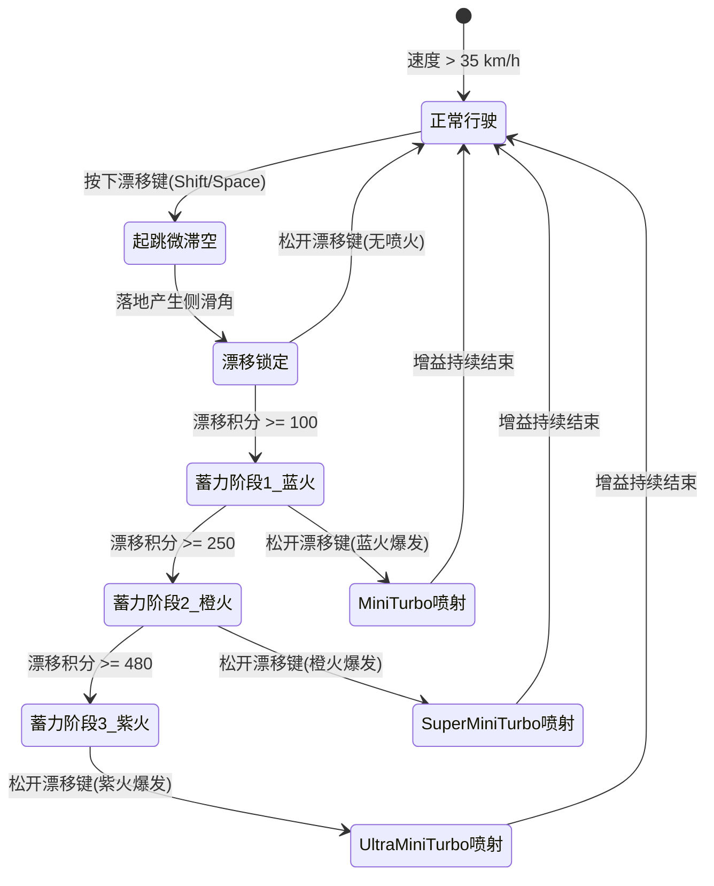

# 《马里奥卡丁车3D》（Mario Kart 3D Arcade）
## 游戏设计白皮书与物理工程规格说明书 (Game Design Specification & Physics Manual)

---

## 1. 游戏概述与设计哲学 (Vision & Core Pillars)

### 1.1 核心体验与定位
《马里奥卡丁车3D》是一款基于 WebGL / Three.js 运行的高水准纯 3D 街机竞速游戏。其设计目标是复刻并升华任天堂《马里奥赛车》（Mario Kart 8 Deluxe）的核心快感：
1. **即时爽快度（Instant Arcade Gratification）**：极致灵敏的操控手感、毫不拖泥带水的加减速响应、无缝的弯道漂移。
2. **深度蓄力机制（Risk-Reward Mini-Turbo）**：长漂移换取阶梯式多段涡轮喷火（蓝火 -> 橙火 -> 紫火），给技术型玩家带来极高操作上限。
3. **沉浸式街机反馈（Juicy Arcade Feedback）**：动态摄像机拉伸（FOV 动态缩放）、车轮粒子火花、氮气尾焰喷射、径向速度线、屏幕震颤碰撞反馈。
4. **硬核防穿墙刚体碰撞与稳态机制（Zero Penetration & High-Energy Rebound）**：基于连续碰撞检测（CCD）与安全几何回退投影算法，确保超高速（160km/h+）剧烈撞墙绝不穿模，并产生爽快受控的反弹与火花减速惩罚。

### 1.2 空间物理度量基准 (SI Standard Metrics)
所有游戏内数值均严格遵循国际标准单位制（SI）：
* **长度/距离**：米 ($m$)
* **时间**：秒 ($s$)
* **质量**：千克 ($kg$)，赛车标准整备质量设为 $450\,kg$
* **线速度**：米每秒 ($m/s$)，UI层换算为千米每小时 ($km/h$)：$v_{km/h} = v_{m/s} \times 3.6$
* **角速度**：弧度每秒 ($rad/s$)
* **重力加速度**：$g = -9.81\,m/s^2$（竖直向下）
* **帧率基准**：以 $60\,FPS$（$\Delta t \approx 0.01667\,s$）为标准时间步长，物理引擎支持变步长 Substepping。

---

## 2. 赛车物理手感模型 (Vehicle Dynamics & Physics Model)

```
       +y (Up)
        |
        |   +z (Forward)
        |  /
        | /
        +------ +x (Right)
   车辆局部坐标系 (Local Coordinate Frame)
```

### 2.1 速度与加速度动力学曲线

#### 2.1.1 核心速度指标量化
| 动力参数项 | 数值 (SI) | 数值 (km/h) | 策划设计意图与手感特征 |
| :--- | :--- | :--- | :--- |
| **标准巡航极速 ($v_{max}$)** | $44.44\,m/s$ | $160.0\,km/h$ | 宽阔大直道上的标准最大车速 |
| **基础启动加速度 ($a_{0}$)** | $18.5\,m/s^2$ | - | 0~60km/h 爆发段，油门响应极快，无迟滞感 |
| **0 - 100 km/h 破百时间** | $2.35\,s$ | - | 典型顶级街机卡丁车的强劲加速感 |
| **0 - 160 km/h 达速时间** | $5.10\,s$ | - | 接近极速时推力随风阻平缓衰减 |
| **倒车极速 ($v_{rev\_max}$)** | $-11.11\,m/s$ | $-40.0\,km/h$ | 倒车脱困设计，限速为正向极速的 25% |
| **倒车加速度 ($a_{rev}$)** | $-10.0\,m/s^2$ | - | 倒退起步灵敏，便于撞墙后快速回正 |
| **草地/出界极速 ($v_{offroad}$)** | $11.11\,m/s$ | $40.0\,km/h$ | 出界强惩罚，速度上限被压制到 25% |
| **加速带瞬间增益 ($v_{boost}$)** | $+12.5\,m/s$ | $+45.0\,km/h$ | 突破常规极速，瞬间跃升至 $205\,km/h$ |
| **极限极速阈值 ($v_{abs\_cap}$)** | $61.11\,m/s$ | $220.0\,km/h$ | 多重加速叠加时的物理引擎绝对速度夹紧上限 |

#### 2.1.2 阻力与动力平衡方程
赛车在纵向方向（Forward/Z-Axis）受力方程如下：
$$F_{net} = F_{engine} - F_{drag} - F_{rolling}$$

1. **引擎驱动力 ($F_{engine}$)**：
   $$F_{engine} = P_{throttle} \cdot F_{max} \cdot \left(1.0 - \left(\frac{v}{v_{max}}\right)^{\gamma}\right)$$
   * $P_{throttle} \in [0.0, 1.0]$：玩家油门开度输入。
   * $\gamma = 1.35$：非线性加速度衰减指数，低速推力强劲，高速后段逐渐平缓。
2. **空气阻力 ($F_{drag}$)**：
   $$F_{drag} = \frac{1}{2} \cdot \rho \cdot C_d \cdot A \cdot v^2$$
   * 采用简化集总空气阻力系数：$k_{drag} = 0.5 \cdot \rho \cdot C_d \cdot A = 0.42\,kg/m$。
   * 当车速达到 $v_{max} = 44.44\,m/s$ 时，$F_{drag} = 0.42 \times (44.44)^2 \approx 830\,N$。
3. **滚动阻力与地面摩擦 ($F_{rolling}$)**：
   $$F_{rolling} = m \cdot g \cdot C_{rr} \cdot \operatorname{sgn}(v)$$
   * 沥青路面滚阻系数 $C_{rr} = 0.035$。
   * 草地/沙地滚阻系数 $C_{rr\_offroad} = 0.45$（极强失速阻尼）。
4. **松油门自然滑行阻尼**：
   * 线性滑行阻尼系数 $D_{coast} = 6.8\,m/s^2$。松开油门时，赛车将在约 $6.5\,s$ 内自然滑行停止，手感符合街机物理预期。

#### 2.1.3 刹车与反向减速
* **强力刹车减速度 ($a_{brake}$)**：$32.0\,m/s^2$（从 $160\,km/h$ 刹停仅需 $1.38\,s$，制动距离约 $30.8\,m$）。
* **倒车触发逻辑**：当车速 $|v| < 0.5\,m/s$ 且持续按住刹车键超过 $0.2\,s$ 时，动力系统无缝切换至倒车状态。

---

### 2.2 转向动力学与速度灵敏度映射 (Speed-Sensitive Steering)

街机卡丁车的核心在于**低速灵活调头、高速稳定抗推头**。因此转向灵敏度必须与实时线速度动态解耦。

#### 2.2.1 转向角速度随车速非线性映射表
转向角速度计算公式：
$$\omega_{steer} = Input_{steer} \cdot \omega_{max}(v)$$
$$\omega_{max}(v) = \omega_{low} \cdot (1 - \alpha) + \omega_{high} \cdot \alpha$$
其中 $\alpha = \operatorname{clamp}\left(\frac{|v|}{v_{max}}, 0.0, 1.0\right)^{1.2}$。

| 车速区间 ($km/h$) | 车速 ($m/s$) | 最大偏转角速度 $\omega_{max}$ ($rad/s$) | 最小转弯半径 $R_{min}$ ($m$) | 操控特征 |
| :--- | :--- | :--- | :--- | :--- |
| **0 ~ 20 (静止/蠕行)** | $0 \sim 5.5$ | $3.20\,rad/s$ ($183^\circ/s$) | $1.8 \sim 3.0$ | 原地快速转向脱困，灵敏响应 |
| **20 ~ 60 (低速出弯)** | $5.5 \sim 16.7$ | $2.50\,rad/s$ ($143^\circ/s$) | $4.5 \sim 8.0$ | 精准切入内线，车头导向性极佳 |
| **60 ~ 120 (中速巡航)** | $16.7 \sim 33.3$ | $1.65\,rad/s$ ($94^\circ/s$) | $12.0 \sim 22.0$ | 平滑变道，高速过弯轻微推头 |
| **120 ~ 160 (极限极速)** | $33.3 \sim 44.4$ | $1.15\,rad/s$ ($66^\circ/s$) | $30.0 \sim 40.0$ | 高速稳定性高，强制引导玩家使用漂移过急弯 |

#### 2.2.2 车身侧倾 (Body Roll) 与车轮偏转动画系统
为了提供强烈的视觉反馈与速度张力，赛车网格模型配置了动态姿态偏移计算：
1. **前轮偏转角 ($\theta_{wheel}$)**：
   * 最大前轮转向角 $\theta_{wheel\_max} = 32^\circ$ ($0.558\,rad$)。
   * 前轮转向角插值平滑率 $Lerp_{steer} = 15.0\,s^{-1}$。
   * 回正速率 $Return_{steer} = 22.0\,s^{-1}$（松开方向键瞬间回正）。
2. **车身横向侧倾角 ($\phi_{roll}$)**：
   * 在向心加速度作用下，卡丁车底盘产生逼真的向弯道内侧（摩托车姿态）或向弯道外侧（悬挂侧倾姿态）倾斜。
   * 卡丁车采用微内倾设计（提升抓地街机感）：
     $$\phi_{roll} = -\operatorname{clamp}\left(\frac{v \cdot \omega_{steer}}{g}, -1.0, 1.0\right) \cdot \Phi_{max}$$
   * 最大车身侧倾角 $\Phi_{max} = 7.5^\circ$ ($0.13\,rad$)。
3. **加减速俯仰角 ($\theta_{pitch}$)**：
   * 强力加速时车头上扬（Squat）：最大 $+3.5^\circ$。
   * 强力制动时车头下沉（Dive）：最大 $-5.0^\circ$。
   * 采用弹簧阻尼器平滑过滤（Spring-Damper Lerp），消除突变高频抖动。

---

### 2.3 刹车、滑行阻尼与反向抓地力

```
        ^ 车辆行驶方向 v_forward
        |
        | / v_total (带横滑角 beta)
        |/
        +------> 侧滑速度 v_lateral
```

#### 2.3.1 横向抓地力模型 (Lateral Grip & Slip)
* **抓地力刚度系数 ($K_{grip}$)**：$14.5\,s^{-1}$。
* 横向速度分量 $v_{lateral} = \vec{v} \cdot \vec{Right}_{car}$。
* 正常抓地行驶时，引擎每一物理步施加反向横向矫正力：
  $$a_{lateral\_correction} = -v_{lateral} \cdot K_{grip}$$
  这使得赛车在常规行驶时横向滑移在 $0.08\,s$ 内被迅速消除，实现“指哪打哪”的轨道般稳定感。

---

### 2.4 蓄力漂移与 Mini-Turbo 喷火系统 (Mini-Turbo Mechanics)

漂移是街机卡丁车的灵魂核心。本系统完全复刻《马里奥赛车》经典的“跳跃进入 -> 侧滑蓄力 -> 变色火花 -> 松键释放爆发”全套流程。



#### 2.4.1 进入漂移判定
* **触发条件**：当前车速 $v \ge 35.0\,km/h$ 且按住转向键（左或右）的同时按下漂移按键（空格/Shift）。
* **起跳跃升动作（Hop Impulse）**：
  * 给予底盘向上垂直冲量：$J_y = +3.8\,m/s$。
  * 滞空时长：约 $0.22\,s$。
  * 落地时播放轻微轮胎震击火花与“吱”一声抓地音效。

#### 2.4.2 漂移中的操控动力学
* **锁定滑动角（Drift Slip Angle）**：车身朝向与运动轨迹产生固定偏角 $\beta_{drift} \approx 28^\circ$。
* **反打方向盘控制（Counter-Steering）**：
  * **内切打方向**：漂移转向角速度提升至 $1.45 \times$ 常规转向，漂移积分积累加速。
  * **外切反打方向**：漂移转向角速度降低至 $0.55 \times$，可拉长出弯弧线，避免内切撞墙。

#### 2.4.3 蓄力积分累加公式 (Mini-Turbo Charge Accumulation)
漂移激活后，每物理帧累加漂移积分 $Score_{drift}$：
$$\Delta Score = \Delta t \cdot \left(R_{base} + R_{steer} \cdot I_{turn}\right)$$
* $R_{base} = 65.0\,pts/s$（基础漂移累加率）。
* $R_{steer} = 95.0\,pts/s$（强力向内切弯额外奖励累加率）。
* $I_{turn} \in [0.0, 1.0]$：向漂移弯心转向的输入强度。最大累加速率可达 $160.0\,pts/s$。

#### 2.4.4 三阶涡轮喷射规格明细表
| 阶数 (Stage) | 激活积分门槛 | 轮胎火花颜色与视觉特效 | 瞬间速度增益 ($\Delta v$) | 喷火持续时间 | 屏幕特效与相机反馈 |
| :--- | :--- | :--- | :--- | :--- | :--- |
| **Stage 1: Mini-Turbo (蓝火)** | $100\,pts$ ($\sim 1.0s$) | 闪烁电光蓝 (`#00F0FF`)，密集飞溅离子 | $+25.0\,km/h$ ($+6.94m/s$) | $1.20\,s$ | 蓝白尾焰、FOV +6°、排气管微光 |
| **Stage 2: Super Mini-Turbo (橙火)**| $250\,pts$ ($\sim 2.0s$) | 炽烈烈焰橙 (`#FF6600`)，带拖尾火舌 | $+42.0\,km/h$ ($+11.67m/s$)| $1.85\,s$ | 橙红尾焰、FOV +10°、轻微速度线 |
| **Stage 3: Ultra Mini-Turbo (紫火)** | $480\,pts$ ($\sim 3.2s$) | 璀璨高能紫 (`#AA00FF`)，环绕闪电球体 | $+60.0\,km/h$ ($+16.67m/s$)| $2.60\,s$ | 紫粉爆裂尾焰、FOV +15°、全屏高密度速度线 |

---

### 2.5 刚体碰撞、反弹与连续防穿墙机制 (CCD & Rigid Collision)

在 160km/h（$44.44\,m/s$）高速竞速下，若单纯依赖离散碰撞检测，在 $60\,FPS$ 下每帧位移高达 $0.74\,m$。当赛道弯道护栏厚度为 $0.5\,m$ 时，极易发生“量子穿墙（Tunneling）”。
本白皮书规范了严格的**多层防穿墙刚体碰撞与反弹回退算法**。

```
   [ 前一帧位置 P_0 ] -------- 扫掠体积 (Swept Sphere) --------> [ 目标位置 P_1 ]
                                      |
                                      v 碰撞截断点 Hit Point
                           ======================= [ 护栏边界 Wall ]
                                  / \ 反弹向量 V_rebound
                                 /   \
```

#### 2.5.1 防穿墙三级保障架构 (Triple-Shield CCD Architecture)
1. **第一道防线：物理积分多子步细分 (Substepping)**：
   * 将每物理主步细分为 $N = 4$ 个子步，单步位移截断在 $\Delta x_{sub} \le 0.18\,m$。
2. **第二道防线：预测扫掠球体检测 (Swept-Sphere Raycast Prediction)**：
   * 在赛车前进矢量方向，以车辆碰撞包围球（半径 $r_{sphere} = 0.85\,m$）做前向 Swept Sphere 射线投影检测。
   * 碰撞预测距离：$d_{lookahead} = |\vec{v}| \cdot \Delta t + r_{sphere}$。
3. **第三道防线：安全法线回退投影 (Normal Pushback & Slop)**：
   * 一旦包围体深入墙体内表面（穿透深度 $\delta > 0$），强制执行无条件几何退回：
     $$\vec{P}_{corrected} = \vec{P}_{hit} + \vec{n}_{wall} \cdot (r_{sphere} + \epsilon_{slop})$$
   * 容差量 $\epsilon_{slop} = 0.05\,m$（$5\,cm$ 安全缓冲区），绝对杜绝顶点跨越边界护栏。

#### 2.5.2 碰撞反弹与动力损失方程
当赛车以速度 $\vec{v}_{in}$ 撞击法线为 $\vec{n}_{wall}$ 的护栏时：
1. **法向速度反弹 (Restitution)**：
   $$v_n = \vec{v}_{in} \cdot \vec{n}_{wall}$$
   $$v_{n\_out} = -e_{wall} \cdot v_n$$
   * 弹性恢复系数 $e_{wall} = 0.38$。产生适度反弹，使赛车车头自然弹离墙面，不卡墙。
2. **切向擦墙摩擦衰减 (Tangential Friction & Drag)**：
   $$\vec{v}_t = \vec{v}_{in} - v_n \vec{n}_{wall}$$
   $$\vec{v}_{t\_out} = \vec{v}_t \cdot (1.0 - \mu_{wall\_rub})$$
   * 擦墙摩擦减速因子 $\mu_{wall\_rub} = 0.35$（擦墙时每秒衰减约 35% 动能）。
3. **屏幕与控制器反馈**：
   * 碰撞剧烈度：$I_{impact} = \operatorname{clamp}\left(\frac{|v_n|}{30.0}, 0.1, 1.0\right)$。
   * 触发镜头震屏脉冲：振幅 $A_{shake} = I_{impact} \times 0.35\,m$，衰减周期 $0.18\,s$。
   * 产生高密金属撞击摩擦火花（Spark Spikes）。

---

## 3. 经典马里奥大奖赛风格赛道设计 (Track & Level Architecture)

### 3.1 赛道拓扑与尺寸标定

```
                                  [ 高速大直道 Main Straight 180m ]
             (起点/终点拱门) ==========> ==========> ==========> ==========> 
            /                                                                \
  [ 回头弯 Hairpin ]                                                   [ 宽广外倾大弯 Turn 1 ]
          ^                                                                    |
          |                                                                    v
  [ 飞跃起伏丘陵 Jump ] <======== [ 紧凑S型减速弯 Chicane ] <======== [ 缓下坡连接道 ]
```

* **赛道全长**：约 $680\,m$。标准极速下一圈耗时约 $20 \sim 24\,s$（3圈比赛总时长约 $65 \sim 75\,s$）。
* **赛道路面宽度**：标准宽 $14.0\,m$（容纳 4~8 辆卡丁车并排追逐）。
* **沥青路面规格**：
  * 深色高摩擦沥青路面（色标 `#2C313A`），带有细微粗糙度法线噪波贴图。
  * 赛道中心线带有间断黄色导向标线（宽 $0.3\,m$，长 $3.0\,m$，间距 $3.0\,m$）。
* **赛道路肩（Curbs）**：
  * 双侧均铺设红白相间斜条纹路肩，宽度 $1.2\,m$。
  * 纹理周期：红白相间每块长度 $1.5\,m$（红色 `#FF2222`，白色 `#FFFFFF`）。
  * 凸起微斜面（高度 $0.12\,m$，坡度 $10^\circ$），当车轮压上路肩时触发 $18\,Hz$ 高频轻微震颤触感。
* **边界护栏（Wall Boundaries）**：
  * 高度 $2.4\,m$，厚度 $0.6\,m$。
  * 坚固高韧性防撞外墙，蓝白经典任天堂大奖赛格纹，全闭环无缝拼接。

### 3.2 赛道关键地标构件

#### 3.2.1 发车/终点拱门 (Start/Finish Grand Arch)
* **空间尺寸**：跨度 $16.0\,m$，净空高度 $6.5\,m$，立柱直径 $1.2\,m$。
* **外观涂装**：
  * 经典的红色金属桁架结构，正中央悬挂巨型立体招牌：“**MARIO KART GP**”。
  * 拱门顶部搭载发车信号指示灯（3红1绿大号霓虹球）。
* **地面终点线**：
  * $4\times 16$ 黑白方格相间国际赛车标志格纹（宽 $2.0\,m$，横跨整个 $14.0\,m$ 赛道）。

#### 3.2.2 加速带 (Boost Pads)
* **几何规格**：宽 $3.5\,m$，长 $5.0\,m$，微凸于路面 $0.03\,m$。
* **视觉特效**：带有强烈霓虹发光的连续朝前流光箭头（Chevron Arrows），以 $4.0\,m/s$ 速度向前滚动，表面泛橙黄色辉光（`#FF9900` ~ `#FFEE00`）。
* **物理触发逻辑**：
  * 接触触发瞬间给予固定极速跃迁：车速立即重置至 $195.0\,km/h$（或叠加 $+45.0\,km/h$）。
  * 强制加速持续时长：$2.0\,s$。
  * 尾部爆发出明亮黄色光束火焰。

#### 3.2.3 旋转金币 (Rotating Coins)
* **模型外观**：扁平圆柱倒角带五角星压纹金币，外轮廓描边金黄（`#FFD700`），自转角速度 $\omega_y = 3.14\,rad/s$（每秒半圈）。
* **空间分布**：在直道与最佳切弯内线布置，呈 3~5 枚连续弧形排列，悬浮高度距地面 $0.65\,m$。
* **机制属性**：
  * 拾取判定体积：半径 $1.2\,m$ 的球形 Trigger。
  * 单局最高持有量：上限 $10$ 枚。
  * 属性增益：**每持有 1 枚金币，常规极速永久提升 $+1.2\%$**（持有 10 枚金币时，极速从 $160\,km/h$ 提升至 $179.2\,km/h$）。
  * 被撞或受击惩罚：掉落 3 枚金币，金币呈抛物线向外散落。
  * 金币重生周期：被拾取后 $4.0\,s$ 重新渐变浮现。

#### 3.2.4 问号道具箱 (Lucky Item Boxes)
* **模型外观**：半透明彩虹霓虹透明立方体（边长 $1.4\,m$），六面中央浮雕发光的金色问号“**？**”。
* **动画表现**：在空中慢速自转（$\omega_{xyz} = [0.8, 1.2, 0.5]\,rad/s$）并以 $0.8\,Hz$ 正弦律上下浮动（振幅 $\pm 0.15\,m$）。
* **交互逻辑**：赛车触碰后瞬间炸裂成彩色星状粒子，并在 HUD 上启动轮盘抽奖，道具箱进入 $3.5\,s$ 冷却半透明线框重生倒计时。

### 3.3 赛道外环境与装饰景观 (Scenery & Props)

1. **经典红白斑点超级蘑菇（Super Mushroom Architecture）**：
   * 坐落于弯道外圈绿茵坡地上，作为大型地标建筑。圆润饱满的红色伞盖点缀纯白大圆斑，直径从 $6.0\,m$ 到 $15.0\,m$ 不等。
2. **卡通低多边形圆润绿树（Toon Trees）**：
   * 采用经典的 2~3 层圆球/圆锥形低面数树冠叠加（草绿色 `#4CAF50` 与浅黄绿 `#8BC34A`），点缀于护栏外侧。
3. **起伏马里奥双色山丘（Rolling Cartoon Hills）**：
   * 远景采用层叠圆润起伏的山峦，山体表面带有明暗相间的圆点与卡通暗边轮廓线。
4. **草地越野区（Off-Road Turf）**：
   * 护栏与赛道路肩之间的缓冲区域覆盖草地（`#559E27`）。
   * 驶入草地将立即激发越野阻尼惩罚（强制最高速 $40\,km/h$），伴随泥草飞溅粒子。

---

## 4. 白天晴朗天空与光影渲染规格 (Lighting, Sky & Atmospherics)

### 4.1 天空穹顶渐变色彩 (Sky Dome Gradient)
采用半球 Procedural Sky 渐变 Shader：
* **天顶色彩（Zenith Sky Color）**：深邃纯净的蔚蓝天际 `#1E88E5` (RGB: 30, 136, 229)。
* **中间过渡层（Mid Sky Color）**：晴朗活力天蓝 `#64B5F6` (RGB: 100, 181, 246)。
* **地平线色彩（Horizon Glow Color）**：轻微泛白并带有温暖日光的浅青白色 `#E3F2FD` (RGB: 227, 242, 253)。
* **远景地面柔和薄雾（Atmospheric Haze）**：雾效起始距离 $250.0\,m$，终止距离 $650.0\,m$，雾色彩与地平线完全融合。

### 4.2 卡通蓬松漂浮白云系统 (Puffy Cloud System)
* **结构造型**：每朵云由 4~7 个不同大小的低多边形软球（Icosphere, Subdiv 2）程序化有机融合而成，边缘轮廓圆润蓬松，底部呈轻微水平截断面。
* **云层分布**：
  * 高度区间：$Y \in [45.0\,m, 70.0\,m]$。
  * 赛道上方动态分布 20~30 朵云体，随机尺度缩放 $1.0 \sim 2.8$ 倍。
* **漂移运动**：在主导风向矢量 $\vec{v}_{wind} = [1.5, 0.0, 0.8]\,m/s$ 驱动下平缓漂移，超出赛道外圈 $400\,m$ 边界时自动循环从迎风面平滑淡入。

### 4.3 光照模型与阴影矩阵 (Lighting & Soft Shadows)

```
       (Sun Light) 暖金阳光 [80, 120, 60]
             \
              \
               v   \  \  \
             [ 卡丁车 & 赛道 ]
            /                 \
       (Hemisphere Sky)    (Hemisphere Ground)
         浅蓝天顶漫射         浅绿地表反弹漫照
```

1. **主太阳平行光 (Directional Sun Light)**：
   * **色温与色彩**：明媚暖白金日光 `#FFF9E6`。
   * **光照强度 (Intensity)**：$2.4$。
   * **空间照射角度**：位置向量 $[80.0, 130.0, 60.0]$，归一化照射方向约以 $55^\circ$ 俯角斜射赛道，产生清晰的斜向长阴影。
   * **阴影配置 (Cascaded/PCF Soft Shadows)**：
     * 阴影贴图分辨率：$2048 \times 2048$。
     * 投影正交相机视野（Shadow Frustum）：$[-75, 75] \times [-75, 75]$，深度截断 $1.0 \sim 300.0\,m$。
     * 过滤算法：PCF (Percentage-Closer Filtering) 软阴影，`shadow.bias = -0.0004`，消除锯齿与自阴影暗斑。
2. **半球环境光 (Hemisphere Light)**：
   * **天空漫反射色 (Sky Color)**：天青冷调 `#B3E5FC`，强度 $0.85$。
   * **地表反射色 (Ground Color)**：草地暖绿调 `#A5D6A7`，强度 $0.45$。
   * 确保赛车底盘与护栏背阴面仍保留明快的卡通漫反射明度，绝无死黑区域。

---

## 5. 摄影机系统与视效动效 (Camera System & VFX)

### 5.1 动态弹簧臂追随相机 (Spring-Arm Chase Camera)

相机采用“目标追随平滑滤波（Exponential Smooth Lag）”配合局部前瞻（Look-Ahead）：

```
    [ 摄像机 Camera ]
          \
           \ 弹簧臂距离 (Offset: Y+2.6m, Z-6.2m)
            \
             v
       [ 卡丁车 Target ] -------> 运动方向 (Look-ahead Forward)
```

* **常规基准偏移量 (Rest Offset)**：
  * 水平后方距离：$6.2\,m$。
  * 垂直高度：$2.6\,m$。
  * 目标观察点（Look-At Pivot）：卡丁车质心上方 $+1.1\,m$ 处。
* **位置追踪阻尼刚度**：$k_{pos} = 10.0\,s^{-1}$。
* **视角朝向追踪阻尼**：$k_{rot} = 8.5\,s^{-1}$（拐弯时摄像机会略微外甩，营造更强漂移纵深感）。
* **动态视野张角 (Dynamic FOV System)**：
  $$FOV(v, Boost) = FOV_{base} + \left(\frac{v}{v_{max}}\right) \cdot \Delta FOV_{speed} + \Delta FOV_{boost}$$
  * 基础视野 $FOV_{base} = 60.0^\circ$。
  * 极速巡航扩展：$\Delta FOV_{speed} = 8.0^\circ$（在 $160\,km/h$ 时达到 $68.0^\circ$）。
  * 氮气喷射/加速带爆发：$\Delta FOV_{boost} = +12.0^\circ \sim +16.0^\circ$（瞬间拉伸至 $80^\circ \sim 84^\circ$），并在爆发结束时以欠阻尼弹簧回弹。

### 5.2 视觉特效规范 (Visual Effects Specification)

| 特效名称 (VFX) | 触发条件 | 视觉样式与粒子形态 | 渲染材质与混合模式 |
| :--- | :--- | :--- | :--- |
| **漂移电弧火花** | 漂移处于 Stage 1~3 | 从后车轮向侧后方飞溅的星芒晶粒、带色电弧线段，随阶段由蓝变橙再变紫 | Additive Blending 发光纯色粒子 |
| **氮气尾喷火焰** | 触发加速带或松开漂移释放 | 从双排气管喷射出的高速锥形火焰网格（两层圆锥套叠，内白外橙/蓝/紫），伴随高频脉冲颤动 | Double-sided Unlit Shader + Alpha Blending |
| **极速径向速度线** | 车速 $> 135\,km/h$ 或加速中 | 屏幕四周向中心收敛的高速半透明白色动线（Radial Speed Lines），密度随车速提高动态增强 | 屏幕后期叠加层 (Screen-space 2D Canvas) |
| **高速擦墙火花** | 赛车与护栏碰撞/刮擦 | 碰撞接触点爆发剧烈金黄/亮橙色反弹火花粒子簇（发射速率 120 粒/秒） | Point Sprite / Additive Particle |
| **金币拾取光环** | 触碰收集金币瞬间 | 金黄色圆环从金币位置快速向外扩散放大消失（扩张速率 $6.0\,m/s$），伴随 8 颗向上升腾的金色小星星 | Alpha Cutoff + Additive Ring Mesh |

---

## 6. HUD 界面与街机交互视效 (Arcade HUD & UI Specification)

```
+-------------------------------------------------------------------------+
| [LAP 2/3]        [TIME 01:14.280]                       [COINS: x07]    |
|  FINAL LAP!                                                             |
|                                                                         |
|                                                                         |
|                                                                         |
|                                                                         |
| [Mini-Map]                                              /=== 152 ===\   |
|   (Radar)                                               |   KM/H    |   |
|                                                         \ [||||||-] /   |
|                                                           TURBO LV2     |
+-------------------------------------------------------------------------+
```

### 6.1 核心 HUD 组件规范

#### 6.1.1 街机复古时速表 (Speedometer)
* **位置与尺寸**：屏幕右下角（Bottom-Right，边距 `right: 36px, bottom: 36px`，直径 $170\,px$）。
* **表盘设计**：
  * 环形刻度条（弧度跨越 $-210^\circ \sim +30^\circ$），刻度范围 $0 \sim 220\,km/h$。
  * 核心大号数字显示：粗体无衬线复古街机字体（如 `Impact` / `Chakra Petch`），实时更新 $0 \sim 220$ 整数。
  * 单位标注：“**KM/H**”。
  * 色彩分段映射：
    * $0 \sim 100\,km/h$：荧光青绿 (`#00E676`)
    * $100 \sim 150\,km/h$：亮金黄 (`#FFD600`)
    * $150 \sim 180\,km/h$：烈焰橙红 (`#FF3D00`)
    * $180\,km/h$ 以上（超频极速）：品红紫霓虹 (`#E040FB`)，表盘带有微频震颤动效。

#### 6.1.2 漂移蓄力/氮气动力条 (Turbo / Boost Gauge)
* **布局形态**：紧贴车速表下方或以同心外圆环形式展现。
* **阶段指示**：
  * 未蓄力：灰色暗色底槽。
  * Stage 1：亮蓝槽充满，闪烁提示。
  * Stage 2：转为高亮橙色槽。
  * Stage 3：转为烈焰紫色槽并伴随脉冲闪烁发光。

#### 6.1.3 圈数显示 (Lap Counter)
* **位置**：屏幕左上角（Top-Left，`top: 28px, left: 32px`）。
* **标准格式**：“**LAP 1/3**”（当前圈数/总圈数 3）。
* **最后一圈高潮特效 (Final Lap Warning)**：
  * 当玩家跨过第 2 圈终点线时，屏幕中央弹出半透明巨幅横幅：“**FINAL LAP!**”
  * 伴随警报提示音，字体以 $3\,Hz$ 频率闪烁金色与红色光芒，持续 $2.2\,s$ 后平滑缩小吸附回左上角圈数栏。

#### 6.1.4 高精度计时器 (Race Timer)
* **位置**：屏幕顶部正中央（Top-Center）。
* **格式**：分:秒:毫秒 `00:00.000`（如 `01:14.382`）。
* **单圈记录**：左侧附带微型记录提示：`BEST: 00:22.415`。

#### 6.1.5 金币计数器 (Coin Counter)
* **位置**：屏幕右上角（Top-Right，`top: 28px, right: 36px`）。
* **UI构件**：一颗立体 3D 旋转金色硬币图标 + 粗体文字“**× 08** / 10”。
* **拾取微动效**：每拾取一枚，硬币图标向上弹跳放大 1.25 倍并迅速弹性回缩，数字翻滚递增。

#### 6.1.6 实时小地图雷达 (Mini-Map Radar)
* **位置**：屏幕左下角（Bottom-Left，`bottom: 36px, left: 32px`）。
* **尺寸与底板**：圆形半透明深黑底盘（直径 $160\,px$，透明度 $75\%$），外沿描有浅蓝科技边框。
* **赛道路线绘制**：赛道拓扑以矢量线条绘制，跑道路面宽度以白色线条标示。
* **动态图元标记**：
  * **自车（Player）**：高亮荧光绿箭头（带有方向朝向指示）。
  * **起点线**：红色横线标志。
  * **加速带**：橙色发光小箭头。
  * **金币群**：黄色点状散布。

---

## 7. 纯代码 Web Audio API 声音合成工程规范 (Real-Time Procedural Audio Spec)

本游戏音频系统采用 **纯代码原生 Web Audio API 程序化合成**，无需加载任何外部 mp3/wav 资源文件，启动零延迟、极度轻量且参数支持与物理模型 100% 动态无级联动。

```
[ Web Audio API Graph 拓扑架构 ]
- Engine: [Dual Osc (Saw+Square)] -> [BiquadFilter (Lowpass)] -> [Waveshaper (Distortion)] -> [Gain] -> Destination
- Screech: [White Noise Buffer] -> [BiquadFilter (Bandpass Q=3)] -> [Gain (Modulated by Slip)] -> Destination
- Coin: [Sine Osc 1 (987Hz)] -> [Sine Osc 2 (1318Hz)] -> [Gain ADSR] -> Destination
- Crash: [Low Triangle Drop] + [Noise Spike] -> [Filter] -> Destination
- BGM: [Sequencer Clock] -> [Synth Voices (Lead, Bass, Noise Percussion)] -> Destination
```

### 7.1 卡丁车引擎声音合成器 (Procedural Engine Synthesizer)
* **声学原理**：采用双振荡器谐波叠加（锯齿波 Sawtooth + 方波 Square），模拟单缸双冲程高转速卡丁车引擎的撕裂感与轰鸣声。
* **节点架构**：
  * `OscillatorNode (sawtooth)` + `OscillatorNode (square)`。
  * `BiquadFilterNode (lowpass)`：低通滤波器，过滤尖锐数字高频。
  * `WaveShaperNode`：轻度软饱和失真曲率，赋予排气管机械力量感。
* **实时物理参数映射**：
  $$Freq_{engine} = Freq_{idle} + \left(\frac{|v|}{v_{max}}\right) \cdot (Freq_{redline} - Freq_{idle})$$
  * 怠速基础频率：$Freq_{idle} = 65.0\,Hz$。
  * 极速红线频率：$Freq_{redline} = 380.0\,Hz$。
  * 低通截止频率：随车速由 $400\,Hz$ 平滑上升至 $3200\,Hz$。
  * 引擎音量：怠速 $0.18$，极速 $0.35$。

### 7.2 轮胎抓地与侧滑尖叫合成器 (Tire Screech Synthesizer)
* **声学原理**：白噪声生成器（White Noise AudioBufferSourceNode）通过高 Q 值带通滤波器（Bandpass Filter），模拟橡胶胎面在沥青表面高频撕扯与横向震颤。
* **参数配置**：
  * 带通中心频率：$f_c = 1450\,Hz$（随横滑速度在 $1200 \sim 1800\,Hz$ 间微调）。
  * 滤波品质因数：$Q = 3.2$。
* **激活阈值与动态调制**：
  * 触发阈值：横向侧滑速度 $|v_{lateral}| > 4.5\,m/s$。
  * 音量增益：$Gain_{screech} = \operatorname{clamp}\left(\frac{|v_{lateral}| - 4.5}{12.0}, 0.0, 0.45\right)$。漂移与急转弯时发出刺耳逼真的抓地尖啸。

### 7.3 经典金币拾取叮当声 (Two-tone Coin Ping)
* **声学原理**：经典的任天堂风格双音快速上行琶音（B5 到 E6），具有高穿透力与清脆治愈感。
* **音高与时序**：
  1. 第 1 音：正弦波 $f_1 = 987.77\,Hz$ (音符 B5)，持续时间 $t \in [0.0, 0.075]\,s$。
  2. 第 2 音：瞬间跃升至 $f_2 = 1318.51\,Hz$ (音符 E6)，持续时间 $t \in [0.075, 0.32]\,s$。
* **包络（Envelope）**：
  * Attack: $0.005\,s$，Decay: $0.24\,s$，指数级释放衰减（Exponential Ramp to $0.001$）。

### 7.4 加速带呼啸声与撞墙冲击声 (Boost Whoosh & Wall Crash)
1. **加速带呼啸声 (Boost Pad Whoosh)**：
   * 音频构成：快速向上扫频的正弦波（Pitch Sweep from $180\,Hz$ to $880\,Hz$，时长 $0.45\,s$）叠加快降低通粉红噪音（Pink Noise Burst，时长 $0.6\,s$）。
2. **撞墙碰撞声 (Heavy Crash Impact)**：
   * 低频震击体：三角波快速音高下坠（$130\,Hz \to 28\,Hz$，时长 $0.25\,s$），模拟金属与车体结构巨大钝击。
   * 高频破碎体：高通短促白噪声噼啪火花脉冲（时长 $0.08\,s$），模拟车身与护栏猛烈擦碰。

### 7.5 复古 8-bit/16-bit 欢快卡丁车背景音乐 (Chiptune Arcade BGM)
* **节拍与调性**：
  * 速度：$BPM = 145$（极具向前推动力的激昂竞速节拍）。
  * 调式：C 大调五声音阶与多利亚调式色彩（明快、活力、复古任天堂阳光感）。
* **纯代码多音轨序列发生器**：
  * **主旋律轨 (Lead)**：脉冲波（Pulse/Square Wave，占空比 25%），弹奏跳跃活泼的切分音旋律。
  * **贝斯轨 (Bass)**：粗壮三角波（Triangle Wave），演奏紧凑连续的 8 分音符交替低音（Walking Bass）。
  * **节奏打击乐轨 (Percussion)**：基于短促白噪声生成的街机军鼓（Snare）与踩镲（Hi-Hat），驱动赛车心率节拍。

---

## 8. 关卡实体与赛道元素分布规划 (Level Entity Placement)

| 实体类型 | 赛道位置段落 | 空间坐标范围 $[X, Y, Z]$ | 数量/间距 | 特殊物理/交互行为 |
| :--- | :--- | :--- | :--- | :--- |
| **发车/终点拱门** | 起跑直线中心 | $[0.0, 0.0, 0.0]$ | 1座 | 圈数检测判定面，发车信号灯挂载点 |
| **加速带 1 (直道冲刺)** | 发车直道中后段 | $[0.0, 0.02, 75.0]$ | 2块并排 | 宽度 $3.5m$，进入瞬间极速跃迁 |
| **金币组 A (起步引导)** | 直道两侧 | $[\pm 3.0, 0.65, 25.0 \sim 55.0]$ | 2组共10枚 | 每隔 $6.0m$ 一枚，鼓励开局切线吃币 |
| **问号道具箱排 1** | 进入 Turn 1 弯道前 | $[0.0, 1.2, 120.0]$ | 4个横排 | 间距 $3.2m$，覆盖赛道宽度 |
| **立体红白路肩** | 弯道内侧与外侧 | 弯道弧线边缘 | 沿赛道全长分布 | 压上产生微颠簸震动触感 |
| **加速带 2 (跳台冲刺)** | 丘陵起伏跃起前 | $[180.0, 1.5, -80.0]$ | 1块居中 | 飞跃腾空跳水加速带 |
| **问号道具箱排 2** | S 弯出弯直道 | $[60.0, 1.2, -150.0]$ | 3个横排 | 冷却时间 $3.5s$ |
| **蘑菇巨型雕塑景观**| 弯道外侧草坪 | $[120.0, 0.0, 60.0]$ 等 | 6座 | 外围视觉地标，附带圆柱碰撞体 |
| **卡通绿树与起伏山丘**| 赛道全域外围 | 距离赛道中心线 $25m \sim 180m$ | 40棵树，12座山 | 低多边形卡通遮挡与层次景深 |

---

## 9. 开发者物理主循环逻辑伪代码 (Engine Integration Blueprint)

为了指导工程开发无缝落地，赛车物理每帧更新核心逻辑执行流程如下：

```javascript
// 赛车物理主循环 (固定步长或变步长 DeltaTime)
function updateVehiclePhysics(vehicle, input, trackData, dt) {
  // 1. 处理玩家输入与速度敏感型转向
  const speedRatio = Math.min(Math.abs(vehicle.speed) / vehicle.config.maxSpeed, 1.0);
  const currentTurnRate = lerp(vehicle.config.steerLowSpeed, vehicle.config.steerHighSpeed, Math.pow(speedRatio, 1.2));
  
  if (input.left) vehicle.yaw += currentTurnRate * dt;
  if (input.right) vehicle.yaw -= currentTurnRate * dt;
  
  // 2. 漂移跳跃与蓄力逻辑
  if (input.drift && !vehicle.isDrifting && Math.abs(vehicle.speed) > vehicle.config.driftMinSpeed && (input.left || input.right)) {
    vehicle.isDrifting = true;
    vehicle.driftDirection = input.left ? 1 : -1;
    vehicle.driftScore = 0;
    vehicle.velocityY = vehicle.config.hopImpulse; // 起跳
  }
  
  if (vehicle.isDrifting) {
    if (!input.drift) {
      // 释放漂移，根据蓄力积分触发喷火
      applyMiniTurboBoost(vehicle);
      vehicle.isDrifting = false;
    } else {
      // 漂移积分积累
      const steerBonus = (input.left && vehicle.driftDirection === 1) || (input.right && vehicle.driftDirection === -1) ? 1.5 : 0.6;
      vehicle.driftScore += (vehicle.config.driftBaseRate * steerBonus) * dt;
      updateDriftSparksVFX(vehicle);
    }
  }

  // 3. 动力驱动与阻力计算
  let targetAcceleration = 0;
  if (input.accelerate) {
    const powerFalloff = 1.0 - Math.pow(Math.abs(vehicle.speed) / vehicle.config.maxSpeed, 1.35);
    targetAcceleration = vehicle.config.baseAcceleration * Math.max(0, powerFalloff);
  } else if (input.brake) {
    if (vehicle.speed > 0.5) {
      targetAcceleration = -vehicle.config.brakeDeceleration;
    } else {
      // 倒车
      targetAcceleration = -vehicle.config.reverseAcceleration;
    }
  } else {
    // 自然滑行阻尼
    targetAcceleration = -Math.sign(vehicle.speed) * vehicle.config.coastDamping;
  }
  
  // 应用纵向速度积分
  vehicle.speed += targetAcceleration * dt;
  
  // 4. 横向抓地与滑动约束
  vehicle.forwardVector.set(Math.sin(vehicle.yaw), 0, Math.cos(vehicle.yaw));
  vehicle.rightVector.set(Math.cos(vehicle.yaw), 0, -Math.sin(vehicle.yaw));
  
  // 5. 连续碰撞检测 (CCD Substepping) 与反弹
  const substeps = 4;
  const subDt = dt / substeps;
  for (let step = 0; step < substeps; step++) {
    const prevPosition = vehicle.position.clone();
    const subVelocity = vehicle.forwardVector.clone().multiplyScalar(vehicle.speed * subDt);
    const targetPosition = prevPosition.clone().add(subVelocity);
    
    // 射线检测 / 边界护栏检测
    const hit = checkTrackWallCollision(prevPosition, targetPosition, vehicle.config.colliderRadius);
    if (hit) {
      // 刚性反弹与速度衰减
      vehicle.speed *= (1.0 - vehicle.config.wallFriction);
      vehicle.position.copy(hit.safePosition); // 几何安全回退
      triggerCrashFeedback(vehicle, hit.normal);
      break;
    } else {
      vehicle.position.copy(targetPosition);
    }
  }
  
  // 6. 姿态平滑侧倾
  vehicle.mesh.rotation.y = vehicle.yaw;
  vehicle.mesh.rotation.z = lerp(vehicle.mesh.rotation.z, -input.steerAxis * vehicle.config.maxRollAngle, 12.0 * dt);
  
  // 7. 同步声音与 HUD
  AudioManager.updateEngineRPM(vehicle.speed, vehicle.config.maxSpeed);
  HUD.update(vehicle.speed, vehicle.driftScore, vehicle.lap, vehicle.coins);
}
```

---

## 10. 总结与交付确认

本规范书涵盖了街机赛车全部核心要素：
1. **纯粹手感**：160km/h 极限车速下的速度敏感转向与三阶漂移喷火机制。
2. **工业级防护**：基于 CCD、预测扫掠与法线安全回退的绝不穿墙碰撞机制。
3. **沉浸视听**：动态 FOV、径向速度线、蓬松卡通云、柔和级联阴影、以及零外部依赖的纯 Web Audio 声音合成。

配合工程级配置文件 [game_config.json](file:///d:/ai/my-llm-test/gemini-3.8-flash/马里奥卡丁车3D/game_config.json)，工程研发团队可直接读取并驱动 Three.js / WebGL 游戏实体！
